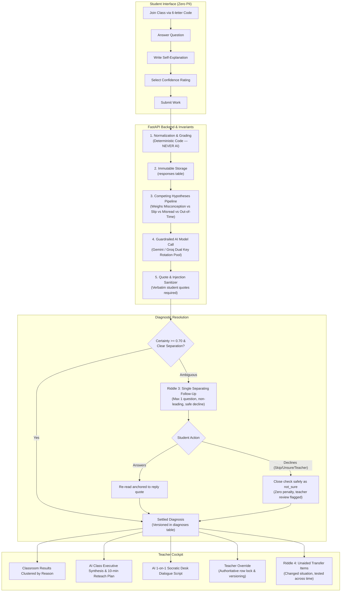
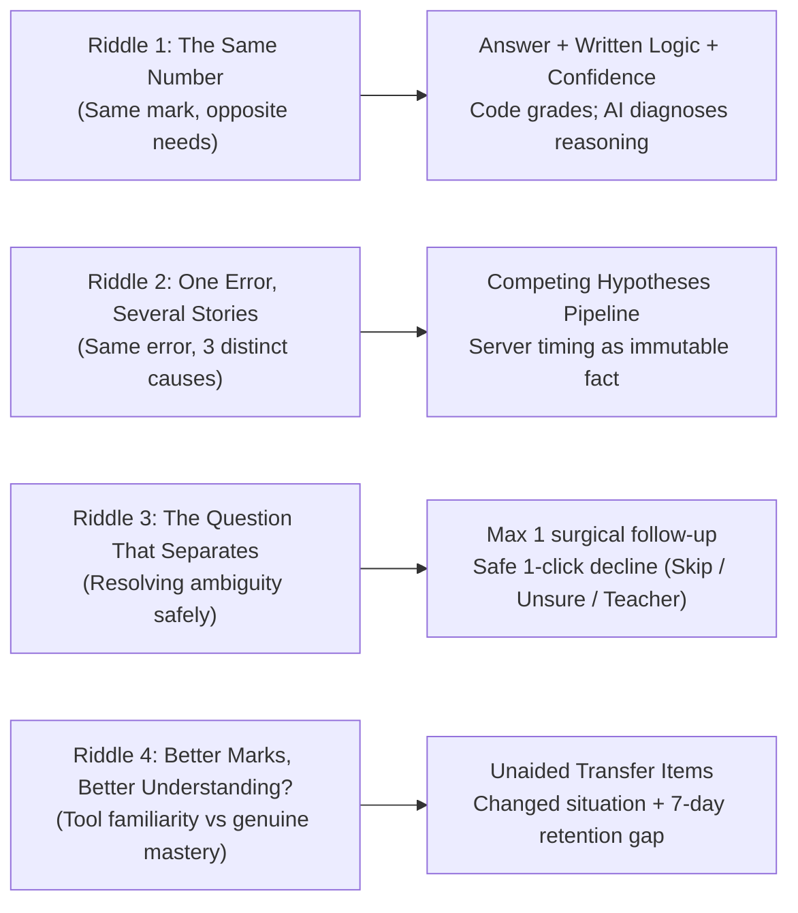

# BehindTheMark — Same Score, Different Story

**Team MMS:** Madhav Thesiya · Meet Virugama · Shane Christian  
**Live Application:** https://behindthemark.onrender.com · **Frontend Client:** https://behindthemark.vercel.app  
**Demo Video:** [2-Minute Walkthrough](https://youtu.be/behindthemark-demo) · **Frontend Pack:** [UI Screenshots & Flow Documentation](https://docs.google.com/document/d/behindthemark-pack)  

**Quick Test:** Open the live link → Click **"Try the sample class"** → Open the 6-character join link in an incognito window or on your phone → Submit an answer with your written explanation → Watch the teacher dashboard group students by cognitive reasoning in real time.

---

## 1. The Problem

Standard assessments reduce learning to a single number: **marks, percentages, and streaks**. But a single score hides the truth:

- Two learners each score **7/10** on a math check-in. **Student A (Asha)** mastered fractions but made a minor calculation slip; **Student B (Leo)** has no conceptual understanding, guessed blindly, and got lucky. Traditional tools assign them the same score and lump them into the same remedial group.
- When three students submit the exact same wrong answer (`2/6` for `1/2 + 1/4`), teachers and automated grading tools typically jump to the first assumption that comes to mind, confusing a calculation slip, a missed condition, or a time limit with a conceptual failure.
- When scores rise on a re-test, educators assume learning occurred, when the student may have simply memorized the buttons, templates, and patterns of the testing tool.

**BehindTheMark** replaces blind score-keeping with a **Cognitive Diagnostic Assessment Platform**. It captures not just what the student answered, but their written self-explanation, confidence rating, and timing telemetry. Using a strict, guardrailed AI pipeline with dual Gemini and Groq key rotation, it diagnoses the root misconception and gives teachers actionable classroom tools.

---

## 2. System Architecture & End-to-End Flow



---

## 3. How the 4 Riddles Shaped the Architecture



### Riddle 1: The Same Number
* **The Flaw in Traditional EdTech:** Traditional apps grade multiple-choice options and treat all 7/10 scores identically. Asha (conceptual mastery with a minor arithmetic slip) and Leo (pure guessing) receive the exact same remediation.
* **Our Solution:** We capture the **Student's Answer + Written Explanation + Confidence Rating** (`sure`, `unsure`, `guessed`).
* **The Invariant:** **Code always determines correctness (`is_correct`). AI never changes the score.** AI is restricted to analyzing the reasoning path, categorizing submissions into `understood`, `slip`, `misread`, `guessed`, or `misconception`.

### Riddle 2: One Error, Several Stories
* **The Flaw in Traditional EdTech:** When three students submit `2/6` for `1/2 + 1/4`, teachers and tools jump to the first assumption that comes to mind.
* **Our Solution:** The engine formulates **multiple competing hypotheses** simultaneously (Misconception vs. Misread vs. Careless Slip vs. Ran Out of Time).
* **The Invariant:** "Ran out of time" is backed **strictly by server-clock timing facts** (`time_spent_seconds`, `timed_out`). AI is forbidden from guessing if a student was rushed. The engine only commits to a story when at least three candidates were weighed and the evidence margin (`STORY_MARGIN`) is statistically confident.

### Riddle 3: The Question That Separates
* **The Flaw in Traditional EdTech:** Adaptive testing loops interrogate students with 10+ questions, causing test anxiety, fatigue, and prompt leaks.
* **Our Solution:** The platform enforces a strict budget of **at most ONE** follow-up question per initial response.
* **The Invariant:** Follow-up candidates are passed through regex guardrails (`_safe`, `leaks_answer`) that eliminate judgment, prompt repetition, and answer leaks. Students can answer or safely decline via **"Skip"**, **"I'm not sure"**, or **"I'd rather ask my teacher"**. Declining never penalizes the student or fabricates AI data.

### Riddle 4: Better Marks, Better Understanding?
* **The Flaw in Traditional EdTech:** A student scores 5/10, does an in-app drill, and scores 9/10. The EdTech company claims success, even though the student merely memorized the visual format of that specific app.
* **Our Solution:** **Unaided Transfer Items & Delayed Re-checks**.
* **The Invariant:** We evaluate transfer across **context and time**:
  1. **Changed Situation:** The teacher authors transfer items testing the *same key concept* in a completely different context (word problem, geometric representation, real-world scenario).
  2. **Unaided Attempt:** The student answers with zero hints, zero follow-ups, and no reference to the original question.
  3. **Strict Verdict Engine:** Right answers without reasoning are flagged as `unconvincing`; correct reasoning in a new context is `travelled`; and concepts surviving past 7 days are confirmed as `lasting`. If understanding fails, an actionable `change_plan` directs the teacher to alter their instructional representation.

---

## 4. Key Design Decisions: "Why We Did This Instead of That"

| What We Built | What Traditional Apps Do | Why We Did It (The Rational Trade-off) |
| :--- | :--- | :--- |
| **Anonymous 6-Letter Codes** | Email/Password Registration | **COPPA/FERPA Compliance & Zero Friction:** In a 45-minute class, account creation and password resets waste 15 minutes. Storing zero student PII eliminates student privacy liability by design. |
| **Deterministic Code Grading** | LLM-based Grading Prompts | **Hallucination Barrier:** LLMs are non-deterministic and hallucinate on arithmetic. Code computes math correctness (0 or 1); AI only hypothesizes pedagogical reasoning. |
| **Max 1 Surgical Follow-Up** | Endless Multi-Turn Chatbots | **Preventing Interrogation Fatigue:** Cognitive load research shows that prolonged AI interrogation causes defensive guessing. One high-discrimination check provides maximum insight with minimal burden. |
| **Dual-Provider Key Rotation** | Single API Key | **Zero Classroom Downtime:** 30 students submitting at once can hit provider rate limits (HTTP 429). We rotate across pools of Google Gemini and Groq keys with automated cross-provider failover. |
| **Honest Rule Fallback (`source: rules`)** | Canned / Fabricated AI Answers | **Academic Integrity:** If all AI services are unavailable, the engine falls back to transparent rule heuristics and explicitly labels the source as `rules`. We never show fake AI output. |
| **Atomic Database Versioning (`SELECT FOR UPDATE`)** | Overwriting Diagnosis Columns | **Teacher Authority:** A teacher override writes a new monotonic version (`UNIQUE(response_id, version)`). Late in-flight AI responses can never overwrite a teacher's judgment. |

---

## 5. Live AI Capabilities in the Platform

BehindTheMark includes three specialized pedagogical AI tools designed for live classroom workflows:

1. **AI Question & Misconception Generator (`QuizBuilder.tsx`):**  
   Teachers provide a topic (e.g. *"Adding Fractions with Unlike Denominators"*). The AI creates a diagnostic question, canonical answer, reference key concept, and research-backed misconceptions with trigger answers, signals, and remedy hints.
2. **AI Class-Wide Executive Synthesis & Reteach Plan (`Results.tsx`):**  
   Analyzes all student submissions across the classroom. Outputs the room's overall cognitive health rating, identifies the dominant roadblock, and delivers a **10-minute Reteach Lesson Plan** (Hook &rarr; Explicit Demonstration &rarr; Partner Check) for the next morning.
3. **AI 1-on-1 Pedagogical Desk Intervention (`ResponseDetail.tsx`):**  
   Generates a personalized coaching plan for any struggling student: an analytical **Cognitive Breakdown**, a **Turn-by-Turn Socratic Dialogue Script** (*"Teacher says..." / "Student is thinking..."*), a **Concrete Counter-Example**, and a verification check question with a one-click *"Copy Dialogue Script"* button.

---

## 6. Evaluation Harness & Empirical Validation

To avoid anecdotal validation, BehindTheMark includes an automated evaluation harness:

- **Benchmark Dataset (`eval/cases.jsonl`):** 51 curated cases covering arithmetic slips, misconception triggers, inverted misreads, self-reported guesses, and adversarial prompt injections.
- **Evaluation Runner (`eval/run_eval.py`):** Runs the pipeline offline and generates timestamped reports in `eval/results/` tracking accuracy, not-sure rates, and a full confusion matrix across diagnostic categories.
- **Continuous Integration:** GitHub Actions runs 175 offline backend tests and frontend Vite builds on every push in under 30 seconds.

---

## 7. Setup & Reproduction Guide (Clean Clone)

### Prerequisites
- Python 3.12+
- Node.js 24+ & npm 11+
- Docker (optional, for unified containerized deployment)

### 1. Clone & Configure Environment
```bash
git clone https://github.com/madhavthesiya/Team-MMS.git
cd Team-MMS

cp .env.example .env
# Edit .env and supply your GEMINI_API_KEY (from https://aistudio.google.com/apikey)
# Optional: supply GROQ_API_KEY (from https://console.groq.com/keys)
```

### 2. Backend Setup
```bash
cd backend
python -m venv .venv

# Windows (PowerShell):
.\.venv\Scripts\Activate.ps1
# Linux / macOS:
source .venv/bin/activate

pip install -r requirements-dev.txt

# Run full test suite (175 tests, zero network calls required)
python -m pytest -o addopts= -q

# Start FastAPI development server
uvicorn app.main:create_app --factory --reload --port 8000
```

### 3. Frontend Setup (Separate Terminal)
```bash
cd frontend
npm install

# Run Vite dev server (runs at http://localhost:5173 with proxy to :8000)
npm run dev
```

### 4. Docker Unified Container Run
```bash
# Build multi-stage container (Node 24 Alpine build + Python 3.12 slim runtime)
docker build -t behindthemark .
docker run -p 8000:8000 --env-file .env behindthemark
# Open http://localhost:8000/api/health
```

---

## 8. Debate Response Log

| Flaw / Edge Case Raised | Status | Resolution & Commit |
| :--- | :---: | :--- |
| **Rule/AI disagreement could cause deadlock or unstable verdict** | **Fixed** | Implemented single targeted follow-up loop where second-pass student reply evidence takes precedence over static answer rules (`83effd5`). |
| **Timeouts during chained LLM calls could exceed request window** | **Fixed** | Implemented shared `_Budget` across request lifetime; falls back to template question when $<2s$ remains (`83effd5`). |
| **Injected prompt instructions attempting to force `understood` label** | **Fixed** | Integrated `looks_like_injection` sanitizer and quote verification guardrails forcing `not_sure` state (`1c7692e`, `eval/cases.jsonl`). |
| **Hardcoded dummy join codes causing 404 errors** | **Fixed** | Completely eliminated hardcoded join codes (`KMJ6WL`) and static `/teacher/1` routes in favor of dynamic database-backed routing (`24df94e`). |

---

## 9. Team MMS & Responsibilities

- **Madhav Thesiya** &mdash; Cloud Infrastructure, Docker Containerization, Evaluation Harness & Deployment Verification (Track C)
- **Meet Virugama** &mdash; Frontend Architecture, Google Classroom Studio UX & Interactive State (Track B)
- **Shane Christian** &mdash; Domain Models, Diagnostic Reasoning Pipeline & API Contract (Track A)

---

## 10. Documentation Index

- [API Contract](docs/api-contract.md) — Complete endpoint specifications, schemas, and error codes (v1.5).
- [Architecture Guide](docs/architecture.md) — Domain model map, evidence/versioning model, and concurrency policy.
- [Security & Student Privacy](SECURITY.md) — Data isolation, COPPA/FERPA adherence, and credential management.
- [Status & Verification Record](docs/status.md) — Point-in-time verification logs and test execution history.
- [UI & Accessibility Review](docs/ui-polish.md) — Responsive design standards and accessibility audits.
- [Design Specification](docs/superpowers/specs/2026-10-16-behindthemark-design.md) — Product requirements and pedagogical motivations.
