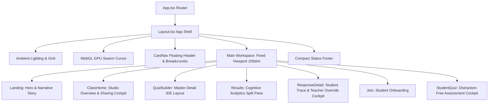
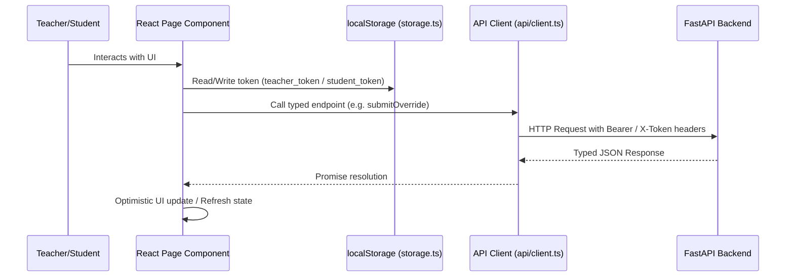

# Frontend Low-Level Design (LLD) & UI/UX Architecture
**Project:** BehindTheMark — Same score. Different story.  
**Role:** Senior Frontend Engineer & UI/UX Architect  
**Version:** 2.0 (Fixed-Viewport & Studio-Grade SaaS Cockpit)

---

## 1. Executive Summary & Architecture Overview

BehindTheMark is an AI-assisted diagnostic assessment platform for STEM education that uncovers what traditional multiple-choice tests conceal: two students with identical 7/10 scores can have radically different cognitive profiles (one made a careless arithmetic slip on a concept they master, while the other guessed or harbor deep misconceptions).

The frontend is built using **React 19**, **TypeScript**, **Vite**, **Tailwind CSS v4**, and **Framer Motion**, communicating with a **FastAPI** backend serving SQLite or Postgres.



---

## 2. Fixed-Viewport Layout & Independent Scrolling Strategy

### Core Architectural Requirement
Desktop and laptop environments must utilize available screen real estate without document-level scrollbars. Application workspaces are bounded to `100dvh` (`max-h-[100dvh] overflow-hidden`). Only designated internal content panels scroll independently (`min-h-0 overflow-y-auto`).

### Viewport Layout Hierarchy

```
+-------------------------------------------------------------------------------+
| App Shell (100dvh, flex flex-col, overflow-hidden)                           |
+-------------------------------------------------------------------------------+
| Header: CardNav + Breadcrumbs + Class Name + API Status (h-[68px], shrink-0) |
+-------------------------------------------------------------------------------+
| Main Workspace (flex-1 min-h-0 min-w-0 overflow-hidden flex)                 |
|                                                                               |
|  +---------------------------+  +------------------------------------------+  |
|  | Master / Nav Panel        |  | Detail / Active Workspace Panel          |  |
|  | (w-72 or w-80, shrink-0)  |  | (flex-1 min-h-0 min-w-0)                 |  |
|  | [min-h-0 overflow-y-auto] |  | [min-h-0 overflow-y-auto]                |  |
|  |                           |  |                                          |  |
|  | - Question list / tabs    |  | - Active Question editor (QuizBuilder)   |  |
|  | - Filters / Summary stats |  | - Cognitive Groupings (Results)          |  |
|  | - Response selector       |  | - Student answer + Follow-up trace       |  |
|  +---------------------------+  +------------------------------------------+  |
|                                                                               |
+-------------------------------------------------------------------------------+
| Compact Footer: Status & Diagnostic Notice (h-[32px], shrink-0)              |
+-------------------------------------------------------------------------------+
```

### Layout Constraints & Best Practices
1. **Root Viewport Guard**: `h-[100dvh] max-h-[100dvh] flex flex-col overflow-hidden` on the outermost shell guarantees that browser scrollbars are never triggered at the document level.
2. **Main Workspace Flex Child**: `flex-1 min-h-0 min-w-0 overflow-hidden` allows children to size dynamically without overflowing their parent.
3. **Internal Scroll Containers**: `min-h-0 overflow-y-auto` with tailored thin monochrome scrollbars (`scrollbar-thin`) ensure that scrolling only happens within specific data panes.
4. **Mobile & Small Tablet Fallback (`< md` / `< 768px`)**:
   - Automatically pivots from side-by-side split pane to stacked view or tabs with smooth internal scrolling.
   - Preserves 44px minimum touch targets and eliminates horizontal overflow.

---

## 3. Google Classroom-Inspired Architecture (Adapted for Cognitive Diagnostics)

To deliver an educational UX that teachers and students find immediately intuitive without blindly cloning proprietary interfaces, BehindTheMark adapts Google Classroom's battle-tested mental models into a sleek obsidian aesthetic:

### 3.1 Unified Class Sub-Navigation (`ClassNav.tsx`)
In Google Classroom, teacher workspaces provide seamless tabs across the top:
- **Stream (`/teacher/:classId#token`)**: Announcement feed, diagnostic scope, class hero banner, and quick code widgets.
- **Classwork (`/teacher/:classId/quiz#token`)**: The structured assignment builder and question repository.
- **Results (`/teacher/:classId/results#token`)**: Cognitive diagnostics, misconception distributions, and "Same Score, Different Story" divergence tables.
- **Persistent Projector Controls**: Quick-access join code chip with one-click full-screen projection.

### 3.2 Classroom Hero Banner & Projector Modal (`ClassCodeModal.tsx`)
- **Classroom Hero Banner**: A high-contrast gradient banner with math lattice overlay, class title, subject/topic, and pinned join code badge.
- **Full-Screen Projector Display**: Teachers frequently project join codes onto whiteboards. Clicking "Project" opens a dedicated modal displaying the 6-character code in 72pt monospace typography with step-by-step student instructions and single-click copy buttons.

### 3.3 Student Assessment Flow: "Assigned" -> "Turn In"
- **Assignment Top Bar**: Clear breadcrumbs showing Class Name, Assignment Title, and an emerald `Assigned` status badge alongside student nickname.
- **"Your Work" Reasoning Scaffolding**: Clearly delineates the answer input from the step-by-step thinking container.
- **"Turn In" Workflow**: Replaces generic "Submit" with educational `Turn In (Submit Answer)` terminology, transitioning to a celebratory "Turned In" state when complete.

---

## 4. Page-Level Component Specifications

### 3.1 QuizBuilder (`/teacher/:classId/quiz`)
- **Pattern:** Studio Master-Detail Split Pane.
- **Left Pane (`w-80 border-r border-white/10 flex flex-col min-h-0 bg-zinc-950/40`)**:
  - Sticky sub-header: Question count, "+ Add Question" button.
  - Scrollable question list: Position number, prompt snippet, answer type pill, misconception counter, move up/down, delete.
- **Right Pane (`flex-1 min-h-0 overflow-y-auto p-6`)**:
  - Active Question Editor:
    - Prompt input & Answer Type selection (`number`, `text`, `choice`).
    - Correct Answer input.
    - Multiple-choice distractors editor (when `choice`).
    - Key Mathematical Idea explanation.
    - Known Misconceptions accordion: Label, trigger answers, signal text, remedy hint.
- **Top Bar (`shrink-0 flex items-center justify-between`)**:
  - Class name breadcrumb, back to class button, Save Quiz action with unsaved badge and loading spinner.

### 3.2 Diagnostic Results Dashboard (`/teacher/:classId/results`)
- **Pattern:** Cognitive Analytics Split Pane.
- **Left Sidebar (`w-80 border-r border-white/10 flex flex-col min-h-0 bg-zinc-950/40`)**:
  - Class summary stats: Total students, accuracy rate, cognitive divergence ratio.
  - Question selector list with accuracy progress bar and misconception distribution tags.
- **Right Detail View (`flex-1 min-h-0 overflow-y-auto p-6 space-y-6`)**:
  - Active Question Diagnostic View:
    - Divergence Banner: "Same Score, Different Story" indicator when identical scores mask disparate reasoning.
    - Two-column student breakdown:
      - **Column A: Correct Answers** (partitioned into *Understood* vs *Guessed/Slip*).
      - **Column B: Incorrect Answers** (partitioned into *Misconceptions* vs *Careless Slip* vs *Unsure*).
    - Student response cards with certainty score, AI signal, and quick link to `/teacher/:classId/responses/:id`.

### 3.3 Response Detail & Teacher Override (`/teacher/:classId/responses/:id`)
- **Pattern:** Evidence Trace & Intervention Cockpit.
- **Left Panel (`flex-1 min-h-0 overflow-y-auto p-6 space-y-6`)**:
  - Student identity, question prompt, submitted answer, self-confidence badge.
  - Student's written explanation with highlighted reasoning cues.
  - AI Diagnosis card (Verdict, Certainty percentage, Hypothesis breakdown).
  - AI Follow-Up dialogue (Teacher/AI probing question & student's clarification).
  - Expandable LLM Execution Trace (model name, latency in ms, prompt version, status).
- **Right Panel (`w-96 border-l border-white/10 bg-zinc-950/70 p-6 flex flex-col min-h-0 overflow-y-auto`)**:
  - Teacher Intervention Cockpit:
    - Diagnosis Override selector (`Understood`, `Careless Slip`, `Misconception`, `Guessed`, `Misread`).
    - Misconception category picker.
    - Private teacher coaching notes.
    - Submit Override action button.
    - Revision history audit log (timestamp, source, previous diagnoses).

### 3.4 Student Assessment Cockpit (`/student`)
- **Pattern:** Focused, Distraction-Free Assessment Viewport.
- **Layout (`max-w-2xl mx-auto h-full flex flex-col justify-between py-6 px-4`)**:
  - Top: Progress bar (e.g. Question 2 of 5) and Nickname badge.
  - Center (`flex-1 min-h-0 overflow-y-auto py-4 space-y-5`):
    - Question prompt card with high-contrast typography.
    - Answer input field (or multiple-choice buttons).
    - Explanation textarea with pedagogical scaffolding: *"Explain how you arrived at this answer step-by-step"*.
    - Confidence selector (3 distinct tactile buttons: *Not sure*, *Pretty sure*, *Very sure*).
    - Dynamic Follow-Up card: when AI asks for clarification, seamlessly morphs into conversational mode without jarring layout shift.
  - Bottom: Clear submit action with loading spinner.

---

## 4. Component Contracts & Reusable UI Primitives

All UI primitives are located in `frontend/src/components/ui/` and adhere to strict TypeScript interfaces:

### 4.1 Button (`components/ui/Button.tsx`)
```typescript
export interface ButtonProps extends ButtonHTMLAttributes<HTMLButtonElement> {
  variant?: "primary" | "secondary" | "outline" | "ghost" | "destructive";
  size?: "sm" | "md" | "lg";
  loading?: boolean;
  loadingText?: string;
  icon?: ReactNode;
  iconRight?: ReactNode;
  leftIcon?: ReactNode;
  rightIcon?: ReactNode;
}
```
- **Accessibility:** Visible focus ring (`focus-visible:ring-2 focus-visible:ring-white/50`), `disabled` and `aria-disabled` handling, screen-reader safe loading spinner.

### 4.2 Input (`components/ui/Input.tsx`)
```typescript
export interface InputProps extends InputHTMLAttributes<HTMLInputElement> {
  label?: string;
  error?: string;
  hint?: ReactNode;
  icon?: ReactNode;
  rightElement?: ReactNode;
}
```
- **Accessibility:** Associates `<label>` with `<input>` via auto-derived or explicit `id`. Renders `aria-invalid` and `aria-describedby` when `error` or `hint` is present.

### 4.3 Textarea (`components/ui/Textarea.tsx`)
```typescript
export interface TextareaProps extends TextareaHTMLAttributes<HTMLTextAreaElement> {
  label?: string;
  error?: string;
  hint?: string;
  showCount?: boolean;
}
```
- **Features:** Dynamic character counter, auto-focus ring, custom scrollbar styling, disabled states.

### 4.4 Tabs (`components/ui/Tabs.tsx`)
```typescript
export interface TabItem {
  id: string;
  label: string;
  badge?: string | number;
  icon?: ReactNode;
}

export interface TabsProps {
  items: TabItem[];
  activeId: string;
  onChange: (id: string) => void;
  variant?: "pills" | "underline";
  size?: "sm" | "md";
}
```
- **Features:** Framer Motion spring-animated background slider (`layoutId="activeTab"`), keyboard navigable.

### 4.5 Modal (`components/ui/Modal.tsx`)
```typescript
export interface ModalProps {
  isOpen: boolean;
  onClose: () => void;
  title: string;
  description?: string;
  children: ReactNode;
  footer?: ReactNode;
  size?: "sm" | "md" | "lg" | "xl";
}
```
- **Features:** Traps focus, handles Escape key press, blurs background backdrop, locks document scroll while open.

### 4.6 Skeleton (`components/ui/Skeleton.tsx`)
```typescript
export interface SkeletonProps extends HTMLAttributes<HTMLDivElement> {
  variant?: "text" | "circular" | "rectangular" | "card";
  width?: string | number;
  height?: string | number;
}
```
- **Features:** Obsidian shimmer effect with `animate-pulse` and `bg-white/[0.06]`.

---

## 5. Design System Tokens & Aesthetics

| Token | CSS / Tailwind Value | Role |
| :--- | :--- | :--- |
| `bg-obsidian` | `#000000` | Deep pitch black background |
| `surface-primary` | `rgba(9, 9, 11, 0.85)` / `bg-zinc-950` | Primary cards, panels, and forms |
| `surface-secondary` | `rgba(24, 24, 27, 0.70)` / `bg-zinc-900` | Hover states, tab backgrounds, wells |
| `border-subtle` | `rgba(255, 255, 255, 0.08)` | Standard panel and card borders |
| `border-focus` | `rgba(255, 255, 255, 0.35)` | Active selection and input focus rings |
| `text-primary` | `#ffffff` | Headings, primary actions, active tabs |
| `text-secondary` | `#a1a1aa` / `zinc-400` | Body text, descriptions, labels |
| `text-muted` | `#71717a` / `zinc-500` | Meta counters, status badges, shortcuts |
| `radius-sm` | `0.375rem (6px)` | Badges, tags, small controls |
| `radius-md` | `0.75rem (12px)` | Inputs, buttons, dropdowns |
| `radius-lg` | `1.0rem (16px)` | Cards, dialogs, slide-over panels |

---

## 6. Data Flow & State Management



- **Teacher Auth:** Token is read from URL hash or `localStorage.getItem("btm_teacher_<classId>")`. Automatically synced via `useTeacherToken()` hook.
- **Student Auth:** Token stored in `localStorage.getItem("btm_student_token")`. Student session is tied to their active quiz progression.
- **Error Handling:** All HTTP errors parse standard FastAPI `{ detail: string }` errors and render inline `ErrorBox` with retry callbacks.

---

## 7. Responsive Breakpoints & Device Adaptation

| Viewport | Dimensions | Layout Strategy |
| :--- | :--- | :--- |
| **Desktop 4K/QHD** | $\ge 1920\times1080$ | Max-width bounded multi-column layout, luxury whitespace |
| **Desktop HD** | $1440\times900$ | Master-detail split pane, fixed viewport height |
| **Laptop** | $1366\times768$ | Compact header, condensed master column (280px), full vertical usage |
| **Tablet Landscape**| $1024\times768$ | Two-column compact layout with collapsible side panels |
| **Tablet Portrait** | $768\times1024$ | Stacked layout, tabbed navigation, internal scrolling panels |
| **Mobile** | $390\times844$ | Single-column fluid layout, sticky bottom action bar, natural scroll |

---

## 8. Verification & Quality Assurance

- **Type Safety:** Verified using `tsc -b` with `noUnusedLocals: true` and zero compiler warnings.
- **Production Build:** Verified with Vite 8.3 (`npm run build`), generating minified assets in `frontend/dist`.
- **Runtime Serving:** Verified FastAPI serves built static assets at `http://127.0.0.1:8080/` with HTTP 200 OK.
