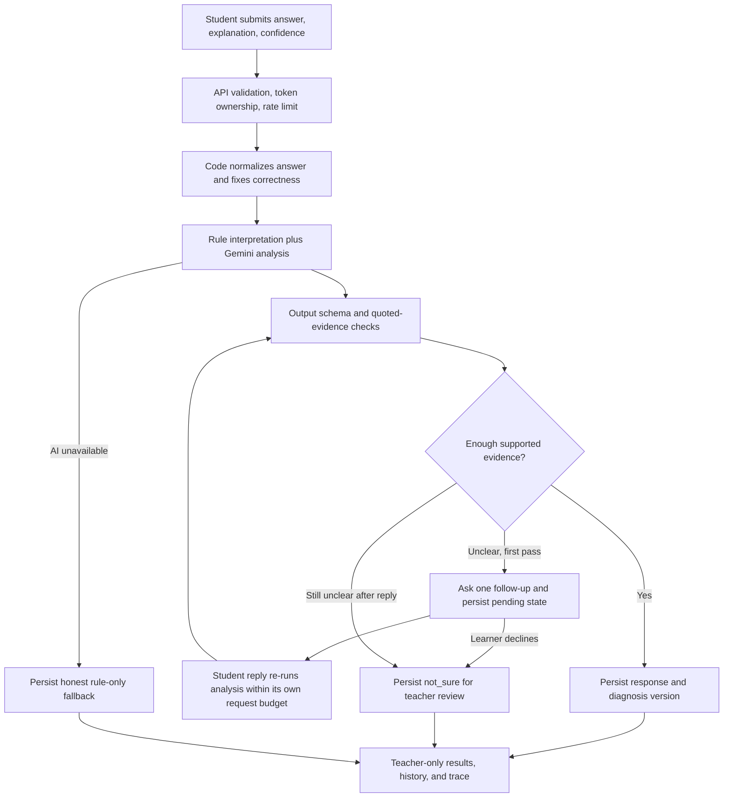

# Architecture

This describes the implementation as of 2026-10-17 (after Riddle 3). Intended behavior is in [api-contract.md](api-contract.md); verification and gaps are in [status.md](status.md).

## Runtime and module map

The implemented service is synchronous FastAPI with SQLAlchemy and a Gemini client. It defaults to a repository-root SQLite database. A configured Postgres URL is rewritten to use the psycopg driver. FastAPI serves the built React frontend (`frontend/dist`) when present; the frontend contains teacher setup/results/detail and student quiz/check flows.

| Area | Files | Responsibility |
| --- | --- | --- |
| Application lifecycle | `backend/app/main.py`, `db.py`, `migrations.py` | App factory, DB setup and additive schema upgrades, routers, optional SPA/static-file serving |
| Runtime configuration | `backend/app/config.py`, `.env.example` | Environment-backed settings and defaults |
| HTTP boundary | `backend/app/api/`, `schemas.py` | Validation, authorization dependencies, response shapes, commits |
| Domain values | `backend/app/domain.py` | Plain question/work/outcome types shared by rules, prompts, and evaluation |
| Persistence | `backend/app/models.py` | Class, quiz, student, evidence, diagnosis, hypothesis, follow-up, AI trace |
| Classroom services | `services/classrooms.py`, `students.py`, `sample.py`, `specs.py` | Quiz setup, safe student views, pending follow-ups, domain conversion |
| Interpretation | `services/normalizer.py`, `rule_matcher.py`, `pipeline.py`, `guardrails.py` | Correctness, rules, AI orchestration, evidence checks, follow-up decisions |
| Small diagnostic checks | `services/followups.py` | Short, safe candidate selection; hypothesis-specific fallbacks; predicted observations distinct from evidence |
| Interpretation storage | `services/diagnosis_store.py`, `results.py` | Versioned diagnoses, teacher overrides, grouped teacher views |
| Model boundary | `backend/app/ai/client.py`, `prompts.py`, `schemas.py` | Gemini transport, versioned prompts, structured output |
| Access and abuse controls | `security.py`, `rate_limit.py`, `api/deps.py` | Token hashes, ownership, public/student rate limits |
| Verification | `backend/tests/` | Synthetic model doubles, API/pipeline tests, opt-in live checks |

## Request flow

The guardrail decision also tracks whether a follow-up is allowed, so the diagram's reply path cannot produce an unlimited sequence of questions. A teacher override always wins: a reply's AI re-read is stored only if the follow-up's diagnosis is still the latest version when it is saved. A reply whose processing never finishes stays resumable (`POST /api/follow-ups/{id}/resume`).

## Evidence and versions

- `Response` stores the original accepted answer, redacted explanation, confidence, and code-decided correctness. `(student_id, question_id)` is unique.
- `Diagnosis` is an interpretation version for a response. Its hypotheses, follow-up, and AI trace belong to that version. The current view selects the highest version.
- A student's follow-up reply is stored on the original `FollowUp` (claimed with a conditional UPDATE and committed before the model call); a reread creates a new diagnosis. An override also creates a new diagnosis with `source=teacher`.
- A decline records `declined_reason` and its timestamp, with no synthetic reply or AI call. Claim and closure share a transaction under the response lock. If no newer version exists, a new `not_sure` reading preserves the hypotheses. It cannot replace a claimed reply or teacher decision; repeated choices are harmless.
- Follow-up rationale and `expected_evidence` are teacher-only proposals about possible replies, never observed facts. Old follow-ups receive empty defaults during schema upgrade.
- Teacher response details combine original student work, current diagnosis, older versions, the follow-up exchange, and trace steps. Student serialization excludes those teacher-only fields.
- Versions are allocated as `MAX(version) + 1` under a row lock on the response (`SELECT … FOR UPDATE` on Postgres), with `UNIQUE(response_id, version)` as a backstop; writers retry on conflict.

## Decision and failure policy

Correctness comes from normalization, not Gemini. Numeric answers compare by rational value; text and choice answers use text normalization. The current choice implementation compares submitted option text, even though the older design spec says "choice by letter"; use the actual schema and contract when building the UI and resolve that wording if changing answer representation.

The AI proposes a label and competing hypotheses. Guardrails verify allowed labels, permitted misconception IDs, correctness-compatible interpretations, and quoted evidence. For a wrong answer the model must weigh every story (mistaken rule, missed condition, ran out of time, slip, guess) and list the rejected ones with a reason; code picks a story only if at least three were weighed and the chosen one leads the next by 0.2. "Ran out of time" comes only from recorded timing (timer auto-submit or the student's tick). Hypotheses are reconciled to one entry per story. Low certainty, unresolved disagreement or a close call leads to one follow-up. A confident label supported by a quote in the follow-up reply can rule out an initial answer-pattern interpretation. Otherwise, the second pass remains `not_sure` for teacher review.

The pipeline shares a configured 30-second budget across model calls within each request and passes remaining time to the Gemini client; each call is also capped by the configured 20-second limit. Less than two seconds remaining skips the model call. The frontend plan uses 45 seconds. These settings express the intended latency budget; verify real elapsed behavior under deployment/network failures before treating it as a hard end-to-end deadline.

The `followup-v2` prompt proposes a primary question and up to two alternatives in one model call, with a rationale and distinct predicted observations for the competing stories. Code rejects over-30-word, repeated, directly answer-revealing or judgemental candidates and incompatible story IDs. Among eligible candidates it prefers the shortest. Legacy question-only output uses code-owned confirmation hints. These checks and word counts are heuristics, not a semantic proof or measured information gain; usefulness needs real-model evaluation and teacher judgement.

Gemini errors, unusable structured output, and time exhaustion fall back to rules or a hypothesis-specific template. If no useful safe template exists, preserve `not_sure` and defer to the teacher. `AIRun` records metadata and parsed outcomes, rather than raw prompts. The health endpoint checks the DB and key presence; it does not call Gemini.

## Performance and Latency Budgets

To deliver responsive classroom interactions and prevent browser timeouts during live instruction, all critical operations operate under explicit latency budgets:

| Endpoint / Operation | SLA Target (p95) | Hard Timeout | Fallback Behavior |
| :--- | :---: | :---: | :--- |
| `POST /api/submissions` (Grading + Diagnosis) | $< 3.5\text{s}$ | $30\text{s}$ shared budget | Code-only grading returns instantly; diagnosis falls back to transparent rules (`source: rules`) if budget $<2\text{s}$. |
| `POST /api/follow-ups/{id}/reply` (Re-read) | $< 3.0\text{s}$ | $20\text{s}$ model cap | Falls back to preserving competing hypotheses as `not_sure` for teacher inspection. |
| `POST /api/follow-ups/{id}/decline` (Skip/Teacher) | $< 100\text{ms}$ | $2\text{s}$ DB timeout | Synchronous atomic DB write; zero AI invocation; closes follow-up immediately. |
| `GET /api/classrooms/{id}/results` (Teacher View) | $< 250\text{ms}$ | $5\text{s}$ DB timeout | Indexed SQL queries; groups pre-computed versioned diagnoses by reason. |
| `POST /api/classrooms/{id}/ai-summary` | $< 5.0\text{s}$ | $25\text{s}$ model cap | Synthesizes class-wide submissions into 10-min reteach plan via Gemini/Groq rotation. |
| `POST /api/responses/{id}/ai-script` | $< 3.5\text{s}$ | $20\text{s}$ model cap | Generates 1-on-1 Socratic desk intervention script for individual student. |
| `GET /api/health` | $< 50\text{ms}$ | $1\text{s}$ | Verifies DB connectivity and API key presence; zero AI calls. |

## Persistence and deployment boundaries

Startup runs `Base.metadata.create_all` for new tables, then `migrations.upgrade_schema` for additive column/index upgrades on existing databases (no data is dropped). The module-level engine/session factory assumes a single configured database per running service. Rate-limit state is held in process memory.

The default deployment serves React and `/api` from one origin; the pulled frontend also supports `VITE_API_URL` for separate hosting. A Dockerfile, `render.yaml`, Vercel config and smoke scripts exist. Do not infer deployment readiness from a production build or local tests alone.
